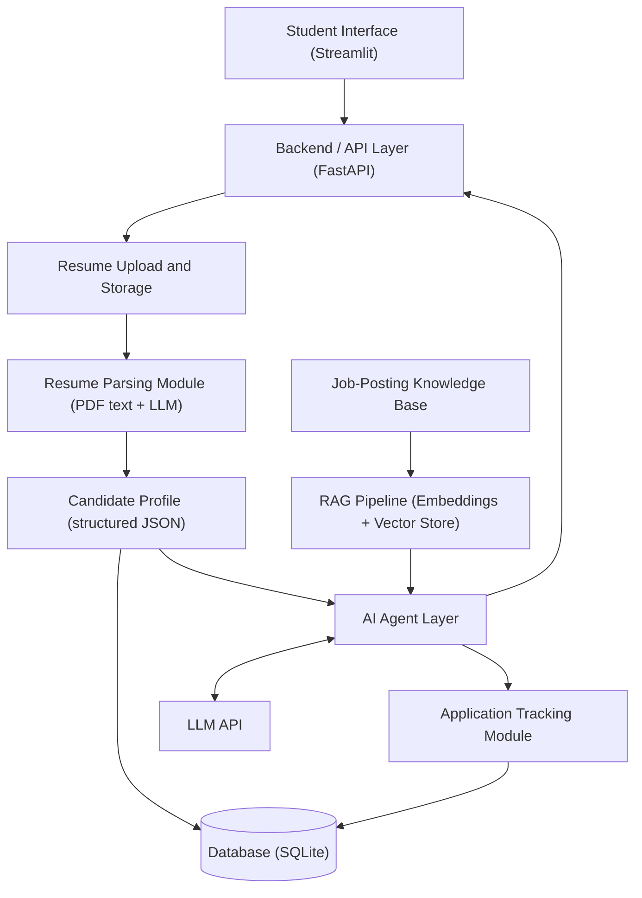

# ACCA: AI Career Companion Agent

**AI Career Companion Agent for Internship Matching and Interview Preparation**

ACCA is a multi-agent AI system that understands a student's resume, matches them with suitable internships, finds their skill gaps, and helps them prepare for applications and interviews.

---

## Problem Statement

Students applying for internships often do not know which internships fit their skills, which skills they are missing, or how to practise for interviews. ACCA builds a structured profile from the student's resume and uses specialised AI agents, backed by a job-posting knowledge base (RAG), to guide the student end to end.

---

## System Architecture (v1)



### Components

| Component | Responsibility |
|---|---|
| Student Interface | Profile creation, resume upload, viewing matches and feedback |
| Backend / API Layer | Connects the UI with parsing, database, RAG and agents |
| Resume Upload and Storage | Accepts resumes and stores files with metadata |
| Resume Parsing Module | Extracts text and converts it to structured data using an LLM |
| Candidate Profile | Structured record of skills, education, experience, projects |
| Database | Stores profiles, resume metadata and application tracking data |
| Job-Posting Knowledge Base | Internship listings, cleaned and embedded |
| RAG Pipeline | Retrieves the most relevant internships for a profile |
| AI Agent Layer | Specialised agents that reason over the profile and retrieved jobs |
| LLM | Used for extraction, reasoning and generation |
| Application Tracking Module | Tracks applied, shortlisted and rejected internships |

### Data Flow

Resume upload → text extraction → LLM-based structured extraction → validated candidate profile → used by the agents.

---

## Agent Roles

| Agent | Responsibility |
|---|---|
| Job-Resume Matching Agent | Matches the profile with internship postings and ranks them |
| Skill Gap Agent | Lists missing skills for a target role with learning suggestions |
| Resume Agent | Reviews the resume and suggests improvements |
| Cover Letter Agent | Generates a tailored cover letter for a selected internship |
| Interview Agent | Runs mock interviews, asks follow-ups, scores answers |
| Career Assistant | Main conversational entry point that routes requests to the right agent |

---

## Tech Stack (proposed)

| Layer | Tool |
|---|---|
| Frontend | Streamlit |
| Backend | FastAPI |
| Database | SQLite |
| Data validation | Pydantic |
| Resume text extraction | pdfplumber / PyMuPDF |
| Structured extraction | LLM with JSON output |
| Embeddings | Sentence-Transformers |
| Vector store | ChromaDB / FAISS |
| Agent orchestration | Custom tool-calling loop, then LangGraph |
| LLM | Gemini API (to be finalised) |
| Version control | Git + GitHub |

---

---

## Milestone 1 Status

| Task | Status | Where |
|---|---|---|
| M1.1 Research | Done | `docs/research-notes.md` |
| M1.2 System architecture | Done | This README (v1) |
| M1.3 Student profile, resume upload, metadata storage | Done | `app/main.py`, `src/db.py` |
| M1.4 LLM resume parsing into a structured profile | Done | `src/llm.py`, `src/resume_parser/`, `src/profile/schema.py` |

### What is implemented

Resume upload (PDF) -> text extraction (pdfplumber) -> LLM extraction (Gemini, JSON output) -> Pydantic validation with retry on invalid output -> candidate profile saved in SQLite.

- `ask_llm()` in `src/llm.py` is the single place for LLM calls, with retry and a fallback model.
- The parser validates the LLM output against the `CandidateProfile` schema and retries with the validation error as feedback.

### Parser evaluation

`scripts/generate_resumes.py` creates synthetic resumes (single and two-column layouts) with ground-truth JSON. `scripts/test_parser.py` compares parser output with the ground truth.

On 5 synthetic resumes, name, email and phone matched exactly, and F1 for skills, projects, experience and education was 1.00 (the match is on skill names, project titles, organisation names and institute names).

Limitations: the resumes are clean and synthetic, and there is no baseline yet, so this is a sanity check and not a measure of real-world accuracy. Next steps are harder layouts (tables, icons, odd formatting) and a regex baseline to compare against.

### Design notes

- In Milestone 1 the Streamlit app calls the modules in `src/` directly. The FastAPI layer from the architecture is planned for Milestone 2; the logic is already in separate functions so endpoints can wrap it.
- Only synthetic resumes are used (`data/resumes/`). Real resumes are not uploaded, because the repo is public and free-tier prompts may be used by the provider.

### Not yet built

Job knowledge base and RAG, the agent layer (matching, skill gap, resume, cover letter, interview, router) and application tracking.

### Run locally

```bash
python -m pip install -r requirements.txt
cp .env.example .env        # add your Gemini API key
python -m streamlit run app/main.py
```

**Author:** Sunita Satpathy| Infosys Springboard Intern
